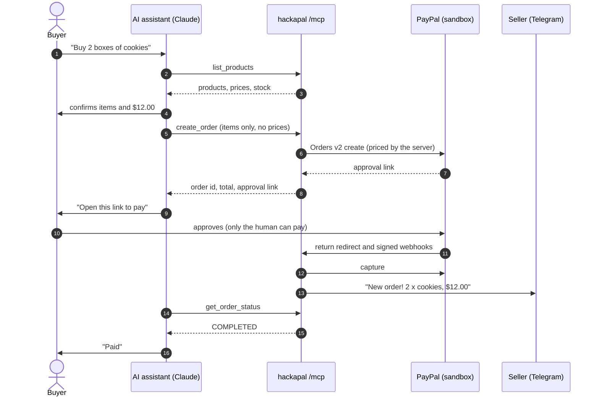

# hackapal

**An agent-ready micro-store:** a small seller with no website gets a shop that AI assistants can browse and buy from over MCP, with PayPal handling the money.

> Built for the PayPal AI Hackathon on Devpost. **Live on PayPal sandbox** at https://hackapal.onrender.com. Every end-to-end check passes, with evidence (order ids, capture ids, verified webhooks) in [docs/BUILD_LOG.md](docs/BUILD_LOG.md).

## Judge quickstart

The demo runs on PayPal **sandbox**: no real money moves. It takes about five minutes.

1. **Wake the shop.** It's on free hosting that sleeps when idle. Open https://hackapal.onrender.com/health and wait for `"status":"ok"`; the first load can take up to a minute.
2. **Connect Claude to the shop.** In claude.ai go to **Settings > Connectors > Add custom connector**. Use the name `Auntie's Kitchen` and the URL `https://hackapal.onrender.com/mcp`, with no authentication. Start a new chat and make sure the connector is switched on for it.
3. **Shop by talking.** Try "What does Auntie's Kitchen sell?", then "Buy 2 boxes of chocolate chip cookies." Claude reads the catalog, confirms the items and the $12.00 total with you, creates the order and hands you a PayPal link.
4. **Pay as the buyer.** Open the link and log in with the sandbox buyer account: _[credentials are in the Devpost submission's testing instructions]_. Click **Pay Now**. You land on "Payment complete, you can go back to your assistant."
5. **Ask Claude "Is it paid?"** It checks with `get_order_status` and only says paid once the status is `COMPLETED`.

**What to look for:**
- **The model can't set prices.** `create_order` takes product ids and quantities only, and the server prices the cart from its own catalog. Try asking Claude to give you a discount.
- **Only the human pays.** Claude hands over a link and never claims payment until PayPal confirms the capture.
- **Stock counts down** only after payment, exactly once per order, even when PayPal's webhook and the return page both report the payment.
- **The seller gets a Telegram ping** for each paid order, and a declined card is recovered by sending the buyer back to PayPal to choose another way to pay. Both are shown in the demo video, because they happen on the seller's phone and through sandbox negative testing.

**Without claude.ai:** any MCP client that speaks Streamable HTTP works. For example, `npx @modelcontextprotocol/inspector` with transport "Streamable HTTP" and the URL above, or `npm run mcp-smoke -- https://hackapal.onrender.com/mcp` from a clone of this repo.

**Limits you might hit:**
- `/mcp` is public but rate-limited: 120 requests a minute per IP, and at most 20 new orders per IP (60 in total) per 10 minutes. Wait a few minutes if Claude reports that the shop is busy.
- An unpaid order simply expires; nothing is charged.

**Demo video:** _[link to be added]_

## How it works

1. An AI assistant (Claude, via a claude.ai custom connector) calls our MCP tools: `list_products`, then `create_order`.
2. The server prices the cart from its own catalog (never from the model), creates a PayPal order with Orders v2 and hands back the approval link.
3. The buyer opens the link and approves in PayPal. Only the human can pay.
4. The server captures the payment, either on PayPal's return redirect or from the verified `CHECKOUT.ORDER.APPROVED` webhook if the buyer closed the tab early.
5. The seller gets a ping, and the assistant checks `get_order_status`. It may only say "paid" once the status is `COMPLETED`.



What's built: the demo shop "Auntie's Kitchen"; server-side pricing in integer cents; the PayPal money path (Orders v2 create and capture, return and cancel pages, verified webhooks, decline recovery); the MCP endpoint with three tools; orders and stock persisted in Supabase; an API key on the internal API with rate limits on the public storefront; and the Telegram seller ping.

## Run locally

You need Node.js 22 LTS (20.12 or newer works) and npm. Windows (PowerShell), macOS and Linux all work.

```bash
npm install
```

Create your `.env` from the template (PowerShell shown; on macOS/Linux use `cp .env.example .env`):

```powershell
Copy-Item .env.example .env
```

Start the server with auto-reload, then open http://localhost:3000/health:

```bash
npm run dev
```

Run the tests:

```bash
npm test
```

## Environment variables

| Variable | Needed for | Notes |
| --- | --- | --- |
| `PAYPAL_ENV` | always | Must be `sandbox`. Any other value refuses to start. |
| `PAYPAL_CLIENT_ID` | PayPal calls | Sandbox REST app client ID. |
| `PAYPAL_CLIENT_SECRET` | PayPal calls | Sandbox REST app secret. Environment only, never committed. |
| `PAYPAL_WEBHOOK_ID` | webhooks | ID of the sandbox webhook that points at `/webhooks/paypal`. |
| `PUBLIC_BASE_URL` | buyer redirects | Where PayPal sends the buyer back. Defaults to Render's `RENDER_EXTERNAL_URL` when present, else `http://localhost:$PORT`. |
| `PORT` | optional | Defaults to 3000. Render sets it for you. |
| `API_KEY` | `/api/*` | 24+ random characters. Sent as `Authorization: Bearer <key>` (or `X-API-Key`). Without it `/api` answers 503. Render generates one. |
| `SUPABASE_URL`, `SUPABASE_SECRET_KEY` | persistent orders | Supabase project URL and secret key (server only). Without both, orders and stock live in memory and reset on restart. Schema: `supabase/migrations/`. |
| `TELEGRAM_BOT_TOKEN`, `TELEGRAM_CHAT_ID` | optional | Seller ping on new paid orders. Both or neither. |
| `LOG_LEVEL` | optional | `debug`, `info` (default), `warn`, `error` or `silent`. |

## Scripts

| Script | What it does |
| --- | --- |
| `npm run dev` | Start with auto-reload (tsx watch). |
| `npm run build`, `npm start` | Compile to `dist/` and run it. This is what Render does. |
| `npm test` | Unit tests (vitest). |
| `npm run typecheck` | Strict type check of `src`, `scripts` and `test`. |
| `npm run money-path -- --base-url <url> [--simulate-decline] [--api-key <key>]` | Test 1: creates an order on our server, prints the PayPal link for the sandbox buyer, follows the status to `COMPLETED` and waits for the verified webhook. |
| `npm run mcp-smoke -- <url>/mcp` | Test 2a: connects to our MCP endpoint, lists the tools, calls `list_products` and `create_order`, prints the PayPal link. |
| `npm run probe-paypal-mcp` | Lists PayPal's sandbox MCP tools with and without `x-feature-flags: commerce:true` (result in the build log). |

## Project layout

```text
src/
  config.ts   env loading and validation (sandbox guard)
  log.ts      JSON-lines logger with secret redaction
  app.ts      Express routes
  server.ts   entry point
  money.ts    integer-cents helpers
  catalog.ts  the demo shop and its products
  pricing.ts  server-side cart pricing and validation
  store.ts    order store interface + in-memory implementation
  supabase-store.ts  the same store on Supabase Postgres (public.orders)
  stock.ts    live stock levels: in memory, or Supabase (taken once per order line)
  telegram.ts seller ping on Telegram when an order is paid (optional)
  auth.ts, rate-limit.ts  API key for /api, limits for the public /mcp
  orders.ts   order service: create, capture (single-flight), webhooks, status
  paypal.ts   PayPal Orders v2 via @paypal/paypal-server-sdk + webhook verification
  paypal-auth.ts  OAuth token cache shared by the SDK and fetch calls
  paypal-http.ts  fetch wrapper: request ids, retries, debug_id logging
  paypal-routes.ts  /paypal/return, /paypal/cancel, /webhooks/paypal
  api-routes.ts     /api/orders (internal API for scripts)
  pages.ts    the small HTML pages buyers see after PayPal
  mcp.ts      POST /mcp: the MCP server (list_products, create_order, get_order_status)
test/         vitest unit tests
scripts/      manual end-to-end scripts (money path, MCP smoke, PayPal MCP probe)
docs/         build log and evidence
```

## Safety rules

- Sandbox only: any `PAYPAL_ENV` other than `sandbox` stops the server at startup.
- Prices come only from the server catalog, and all money math is in integer cents.
- Credentials come only from environment variables, and logs redact secret-looking keys.
- Orders v2 only (no `v1/payments`, NVP or SOAP), through `@paypal/paypal-server-sdk`.
- A `PayPal-Request-Id` on every POST (`create-<order>`, `capture-<order>-<attempt>`), one cached OAuth token, retries with backoff on 429/5xx/network errors only, and the PayPal `debug_id` logged on every error.
- `/api/*` needs the `API_KEY`. `/mcp` is the public storefront (any buyer's assistant must reach it), so it is rate-limited instead: 120 requests a minute per IP, and `create_order` at most 20 per IP and 60 in total per 10 minutes. Creating an order moves no money and takes no stock.
- Webhooks are verified with PayPal using the raw request body, byte for byte, before anything is processed. Duplicates are skipped and statuses never move backwards.

## Deploy to Render

`render.yaml` is a Blueprint for one Node web service (Singapore, free plan for now, health check `/health`). The free plan sleeps after about 15 minutes idle and takes about a minute to wake; orders and stock survive because they live in Supabase. See design decision 14 in the build log. In the Render dashboard choose **New > Blueprint**, pick this repo and branch, and enter the PayPal sandbox credentials when asked. After the first deploy, create a sandbox webhook pointing at `https://<service>.onrender.com/webhooks/paypal` and put its ID in `PAYPAL_WEBHOOK_ID`. The build log has the step-by-step version.

## License

[MIT](LICENSE)
